<p align="center">
  
</p>

<h1 align="center">LudrixHub</h1>

<p align="center">
  Portable game launcher for Windows.<br>
  Library, emulators and Store in one place — no account, no installer, nothing running in the background.
</p>

<p align="center">
  <a href="https://github.com/wolffZ-prog/Ludrix/releases/latest"></a>
  <a href="https://github.com/wolffZ-prog/Ludrix/releases"></a>
  
  
  <a href="LICENSE"></a>
</p>

<p align="center">
  <a href="#download">Download</a> ·
  <a href="#where-ludrix-stands-today">Today</a> ·
  <a href="#screenshots">Screenshots</a> ·
  <a href="#themes">Themes</a> ·
  <a href="#game-sources">Sources</a> ·
  <a href="#build">Build</a> ·
  <a href="docs/">Docs (pt-BR)</a> ·
  <a href="README.md">Português</a>
</p>

<p align="center">
  
</p>

---

## Download

| File | Who it is for |
|---|---|
| **`Ludrix-<version>.zip`** | The ready-to-run program. Extract anywhere (USB stick or external drive included) and open `Ludrix.exe`. Nothing is installed on the system. |
| `ludrix-<version>-patch.lxup` | Update. Ludrix downloads and applies it on its own from **Settings → System → Check for updates**; it can also be dragged onto the window. |
| `ludrix-<version>-full.lxup` | Full update (program + runtime). Only published when the runtime changes. |
| `Ludrix-<version>-src.zip` | Source code of that same version, built with `build.bat`. |
| `LudrixHub-<version>-x86_64.AppImage` | Linux (experimental). Data lives in `~/.local/share/Ludrix`. |

Latest version: **[Releases](https://github.com/wolffZ-prog/Ludrix/releases/latest)**. Full history in [CHANGELOG.md](CHANGELOG.md) (pt-BR). Only the two most recent releases stay published; older ones are removed.

Requirements: Windows 10 or 11, 64-bit. No account, login, WebView2 or installation — the runtime ships inside the folder.

## Where Ludrix stands today

The 4.0 series replaced the old Python engine with Electron + TypeScript while keeping the same data folder. The current version is **4.0.19**, and this is the state of the project:

- **One library.** PC games, ROMs and quick games (Flash/HTML5) sit together in an alphabetical grid with letter dividers, covers, categories and combinable filters. The selected game is featured at the top with its own background art, Play, Details and Folder.
- **A Store fed by sources.** No catalogue is bundled. The Store only shows what the `.json` lists, web pages, archive.org collections, GitHub repositories or local folders added by the user provide. Direct download, file hosts and torrent (no DHT, UPnP or NAT-PMP).
- **Ready-to-use emulators.** 25 systems and 45 emulators catalogued, installed from the official site in one click and kept inside the Ludrix folder. ROMs join the Library with covers and open with the emulator chosen for that system.
- **The "Base" look.** Flat interface, solid colour and thin lines, 13 px base size, Rubik typeface and Tabler icons. Two built-in themes (Dark and Light, truly black and white) plus external `.lxtheme` themes. Optional Glass (Windows 11 acrylic) with cards and popups always solid on top.
- **Light motion.** Animations are short and independent from Windows' animation settings; "Reduce motion" turns everything off. Switching pages is instant, with no flashing or content shifting.
- **Colour fog.** Soft accent-coloured patches drift slowly across the window background like clouds — behind the side bar too. Intensity from 0 to 100 in Settings › Appearance.
- **The navigation bar your way.** Side with names, side with icons only, top, bottom, or **floating**: detached from the content with rounded corners — with names or as square icon tiles.
- **Fast on hard drives.** The library opens from a cold cache while the disk spins up; the integrity check runs afterwards without holding the screen. An optional script (`Ludrix-HDD.ps1`) tunes Windows for mechanical drives without touching any data.
- **Portable and predictable.** Everything stays in the folder (`data/`, `games/`, `emulation/`, `downloads/`). Nothing is written outside it, nothing keeps running after Quit, and every update replaces the whole program while keeping only user data.
- **Brazilian Portuguese and English**, with everything new landing in both languages at the same time.

## What it does

**Library**
- Imports from Playnite, Steam, Epic, GOG, Ubisoft Connect, EA app, Battle.net, Amazon Games, itch.io, Heroic, ES-DE, LaunchBox, Pegasus and Windows shortcuts. Names typed by the user are never changed.
- Covers, background art, description, year, developer, screenshots and requirements fetched automatically (Steam, GOG, Wikipedia, Wikidata — no API key), with a candidate list to pick the right game. Everything is editable; a picked image replaces the previous one.
- Status (planned, playing, finished, 100 %, on hold, dropped), 1–10 rating, favourites, tags (`tag:` in search), collections and groups. Search prefixes: `dev:`, `ano:`, `gen:`, `sis:`, `origem:`, `tag:`.
- Right-click any game: play, open folder, change cover, mods, saves, desktop shortcut, verify files, move game folder, Requirements vs. this PC.
- Duplicates are detected and never shown twice. Automatic save backups. Export/import the whole library in one file; export to Steam.
- Controller navigation (couch mode), a dice to pick a random game, cover slideshow, configurable hotkeys, optional Discord Rich Presence.

**Store by sources**
- Accepted in **Store → Sources**: `.json` list (`ludrix-pack/1`), web page, archive.org collection or item, GitHub repository, local folder, Hydra-format lists.
- Staged downloads, pause, scheduling, queue with history. Extracts `.zip`/`.7z`/`.rar`, runs installers, mounts disc images and asks before creating shortcuts.
- Native recompilations and ports (N64, Xbox 360, PS1…) come straight from GitHub, always the latest build. Ready-made list: [`Recomps.json`](docs/FONTES.md#recomps).

**Emulators**
- PCSX2, DuckStation, PPSSPP, Dolphin, melonDS, Xenia, mGBA, Snes9x, Rosalie's Mupen GUI, Eden and more. Several emulators per system, BIOS detection, shallow ROM folder scanning (never freezes the interface).

**Hub**
- Dependencies almost every game needs (Visual C++, DirectX, .NET, PhysX…): detects what is missing and installs in batch. Minecraft: detects the official launcher and alternatives. Disk space per folder.

**Console Mode**
- Separate executable (`LudrixConsole.exe`) for TV and controller: big covers, stick/D-pad navigation, the same tabs as the launcher.

**System**
- Playnite-style tray, start with Windows (optional), single instance per folder, window size and position memory, diagnostics zip, crash watch.
- Signed updates (Ed25519). A package without a valid signature is never applied. If an update fails to open twice in a row, Ludrix rolls back to the previous version on its own.

## Screenshots

<table>
  <tr>
    <td><br><sub>Details: background art, description, metadata, screenshots, requirements</sub></td>
    <td>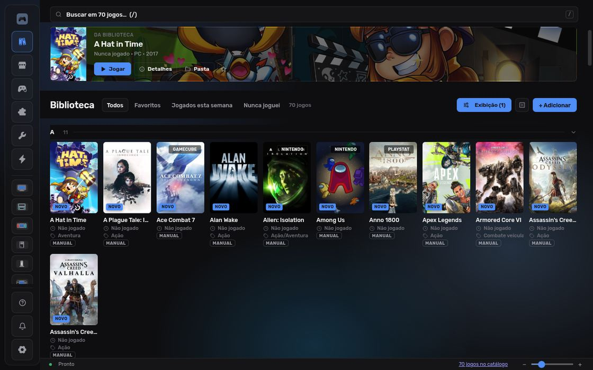<br><sub>Floating navigation bar, square tiles</sub></td>
  </tr>
  <tr>
    <td>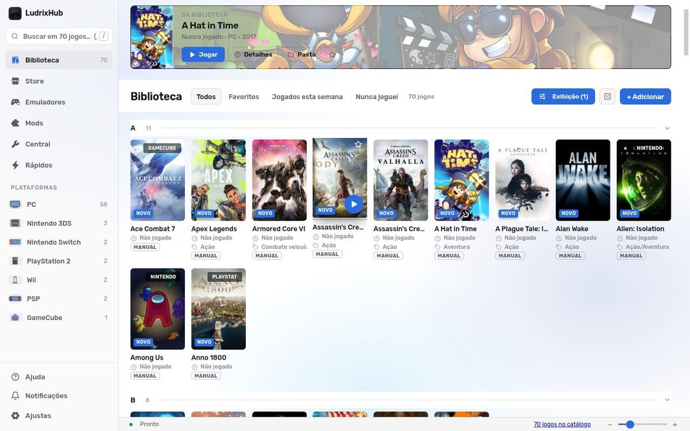<br><sub>Built-in Light theme with colour fog</sub></td>
    <td>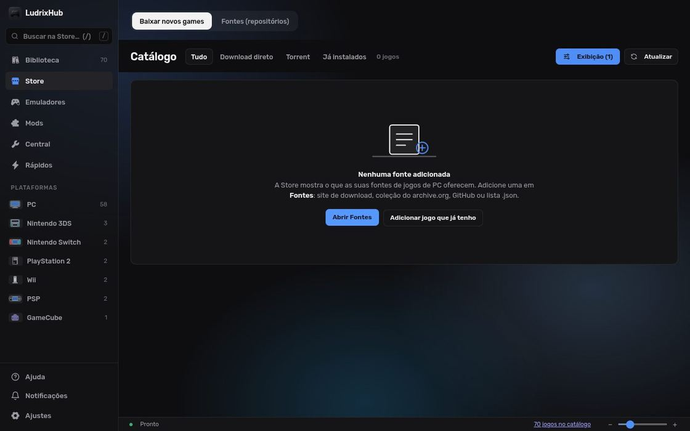<br><sub>Store: empty until a source is added</sub></td>
  </tr>
  <tr>
    <td>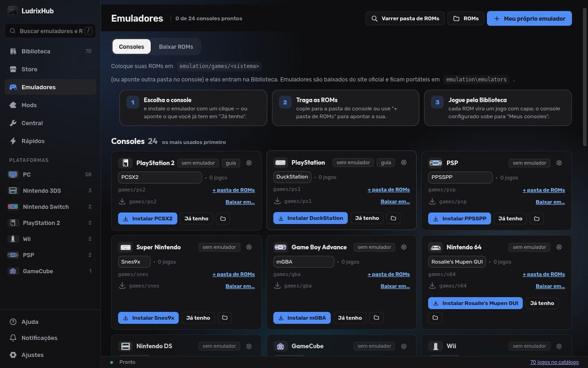<br><sub>Emulators: install, point to ROMs, pick the core</sub></td>
    <td>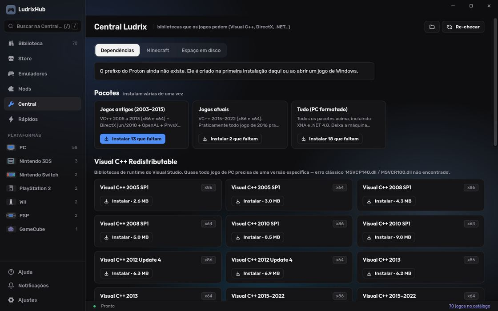<br><sub>Hub: dependencies, Minecraft, disk space</sub></td>
  </tr>
  <tr>
    <td>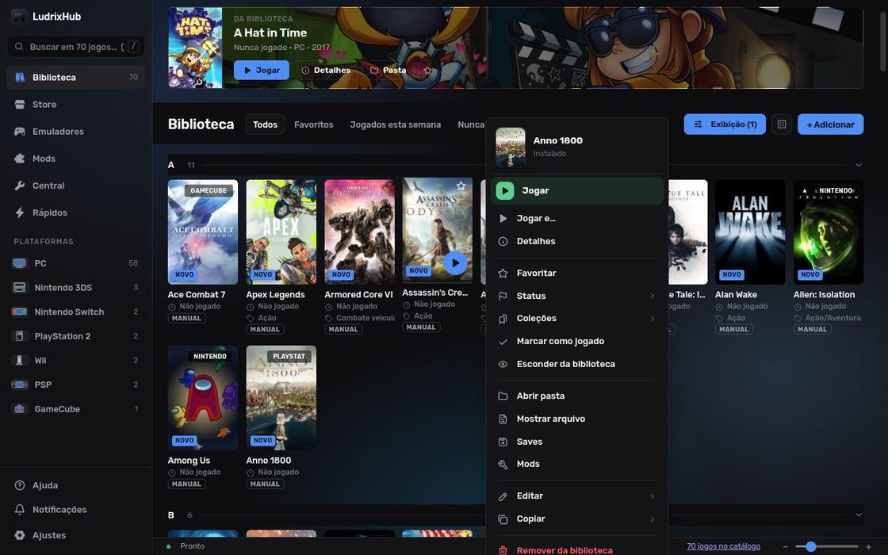<br><sub>Right-click menu in the theme's colours</sub></td>
    <td>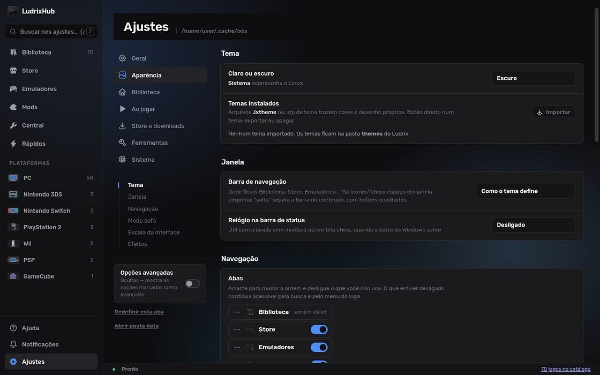<br><sub>Settings: organised tabs, instant effect</sub></td>
  </tr>
</table>

## Themes

A theme is a folder with a `theme.json` (colours, accent, bar layout, icons) plus, optionally, an `extra.css`, wallpapers and fonts — or that folder zipped as `.lxtheme`. Import it in **Settings › Appearance › Import theme**; system theme and a light/dark schedule live there too. Full format in [docs/TEMAS.md](docs/TEMAS.md) (pt-BR).

Besides the two built-in ones there is a pack of **experimental themes**, made to test how far the format goes: layered backgrounds with parallax, top or bottom bars, custom typography, Windows XP reinterpretations. Some of them:

<table>
  <tr>
    <td>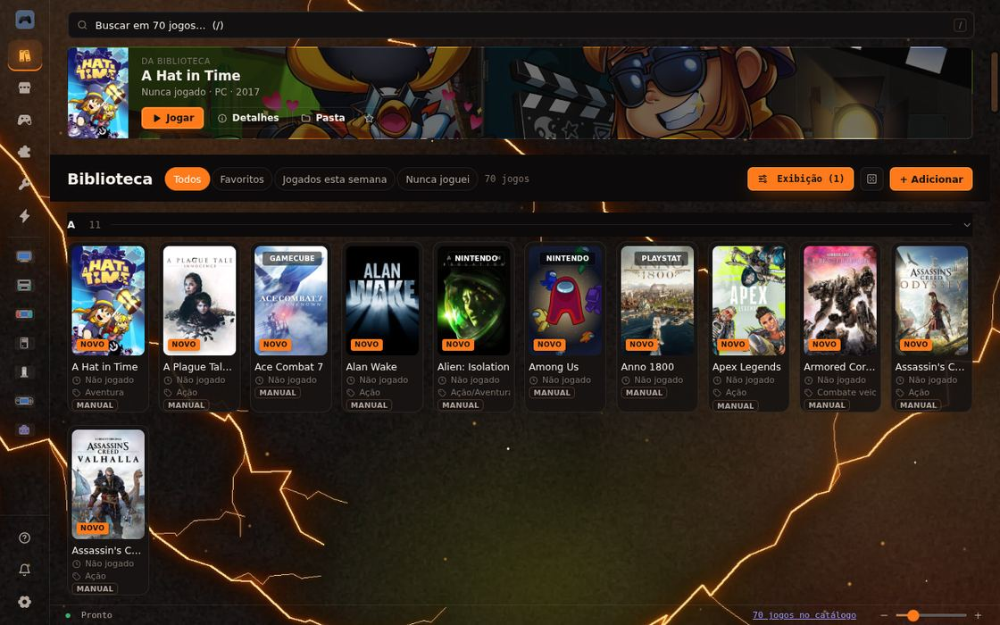<br><sub><b>Magma</b> — volcanic rock and lava in parallax layers</sub></td>
    <td>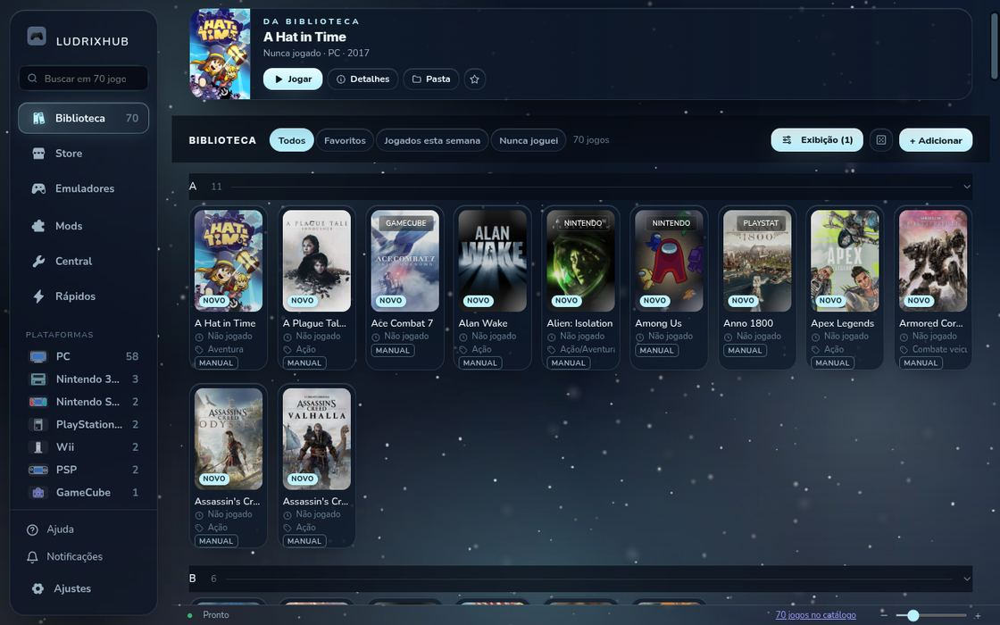<br><sub><b>Nevasca</b> — snow in depth, translucent side bar</sub></td>
  </tr>
  <tr>
    <td>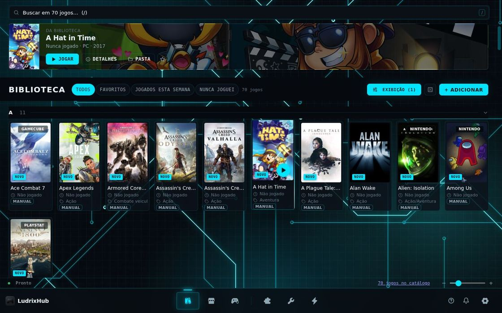<br><sub><b>Circuito</b> — circuit board, bottom pin bar</sub></td>
    <td>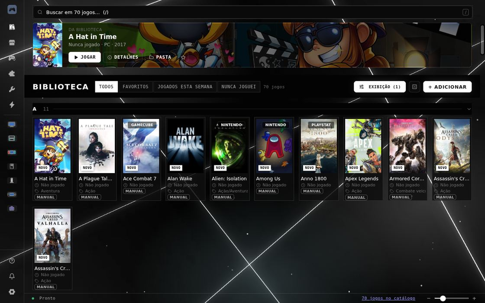<br><sub><b>Laser</b> — absolute black and white, parallax beams</sub></td>
  </tr>
  <tr>
    <td>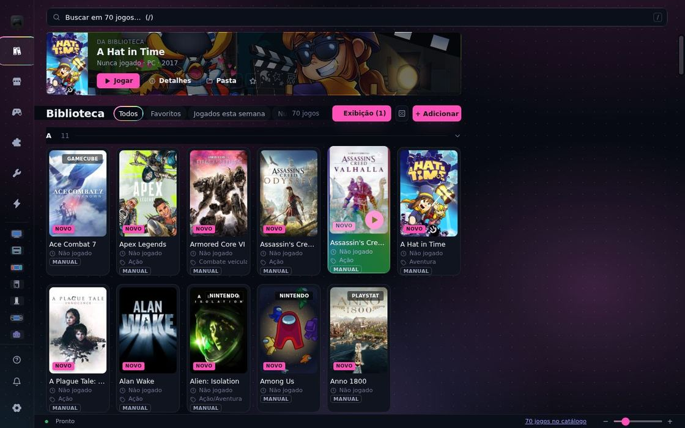<br><sub><b>Prisma</b> — dark gradient with magenta accent</sub></td>
    <td>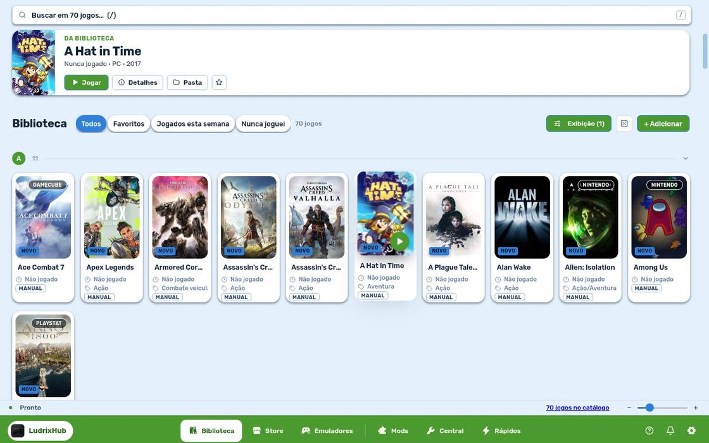<br><sub><b>Bliss</b> — light Windows XP reinterpretation, green bottom bar</sub></td>
  </tr>
  <tr>
    <td>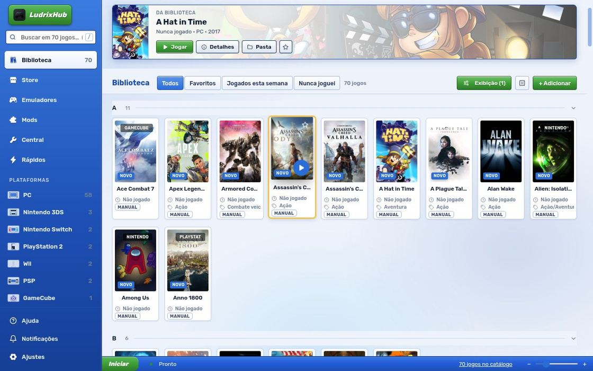<br><sub><b>Luna Nova</b> — Luna blue, classic side bar</sub></td>
    <td>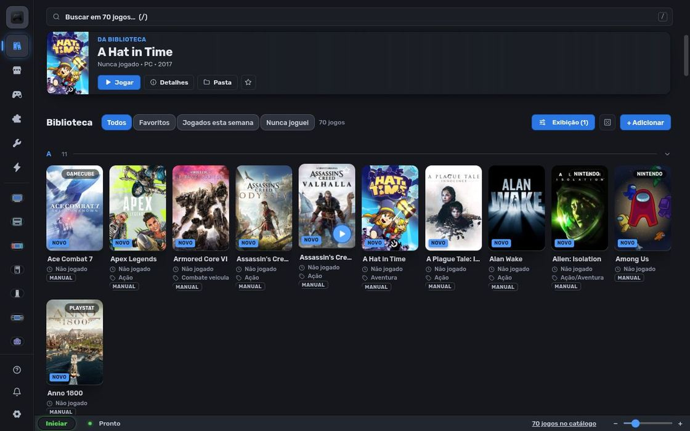<br><sub><b>Royale Noir</b> — the dark Royale, Start button included</sub></td>
  </tr>
</table>

Experimental themes may change or disappear between versions; the two built-in ones are the reference.

## Game sources

The Store only shows what its sources provide. Accepted in **Store → Sources**:

| Type | Example |
|---|---|
| `.json` list (`ludrix-pack/1`) | local file or link; format in [docs/FONTES.md](docs/FONTES.md) |
| Web page | Ludrix reads the page and lists the games it finds |
| archive.org collection or item | collection link |
| GitHub repository | releases with a Windows build |
| Local folder | games already sitting on another disk |
| Hydra-format lists | compatible |

Ready-made packs ship with each release: `Colecoes.zip` with **PC Collections**, **ROMs Collection** and **Recomps** (native recompilations/ports with Windows builds, based on [Recompendium](https://github.com/Nio03/unricopie)).

## Build

```bat
git clone https://github.com/wolffZ-prog/Ludrix.git
cd Ludrix
build.bat                     :: installs Node if missing, fetches dependencies and produces release\<version>\Ludrix\
node tools\build.js all       :: folder + zip + patch + full + src + feed (signed when the key is present)
```

Needs Windows and Node.js 20+ (`build.bat` installs it through winget if missing). `node tools\check.js` runs tsc and checks renderer syntax, JSON files, translations, routes and config keys — it is the gate before any release. Details in [docs/COMPILAR.md](docs/COMPILAR.md).

Layout:

```
src/main/        main process (TypeScript): local server, library, Store, emulators, updater, tray
src/main/assets/ catalogues (emulators, dependencies, categories), icons, native executables
src/renderer/    interface (HTML/CSS/JS), Base look, console mode, translations
tools/build.js   build, packaging, signing, update feed, publishing
tools/check.js   code integrity checks
tools/native/    Ludrix.exe, LudrixConsole.exe and ludrix-gamepad.exe (C, mingw)
docs/            documentation and screenshots
```

## Updates

Ludrix polls this repository (`releases/latest/download/ludrix-updates.json`). When a new version is out it notifies; once accepted, it downloads, verifies the signature, applies and reopens. Quick fixes (`-hfN`) arrive the same way and replace only the changed files. A custom `https` address or a manual `.lxup` file also work. More in [docs/ATUALIZACOES.md](docs/ATUALIZACOES.md).

## Security

- Local server bound to `127.0.0.1` only, stable port per folder, per-session token, origin check, path allowlist and CSP; sandboxed renderer.
- Update packages signed with Ed25519; the private key is never in the code.
- Torrent without DHT, UPnP, NAT-PMP or local discovery.
- No telemetry, no account, no ads, no plugins, no AI.

Found a problem? See [SECURITY.md](SECURITY.md).

## Contributing

Issues and pull requests are welcome — read [CONTRIBUTING.md](CONTRIBUTING.md) first. Short rules: no comments or docstrings in code, direct interface text with no narration, everything in pt-BR and English at the same time, nothing runs in the background unless the user turns it on.

## Credits

**WOLFFZ — creator and originator of the project.**

Libraries: [Electron](https://www.electronjs.org/), [TypeScript](https://www.typescriptlang.org/), [webtorrent](https://webtorrent.io/), [adm-zip](https://github.com/cthackers/adm-zip), [electron-log](https://github.com/megahertz/electron-log). Icons based on [Tabler Icons](https://tabler.io/icons). Typeface [Rubik](https://fonts.google.com/specimen/Rubik).

[MIT](LICENSE) licence. Games, covers and trademarks belong to their owners; Ludrix does not distribute games.
