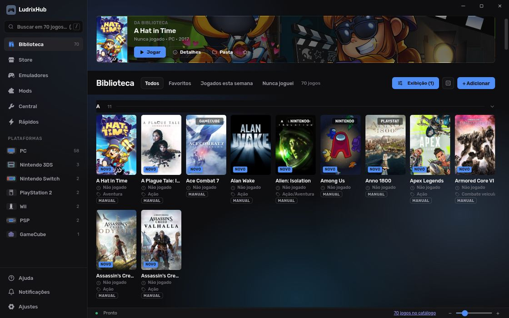
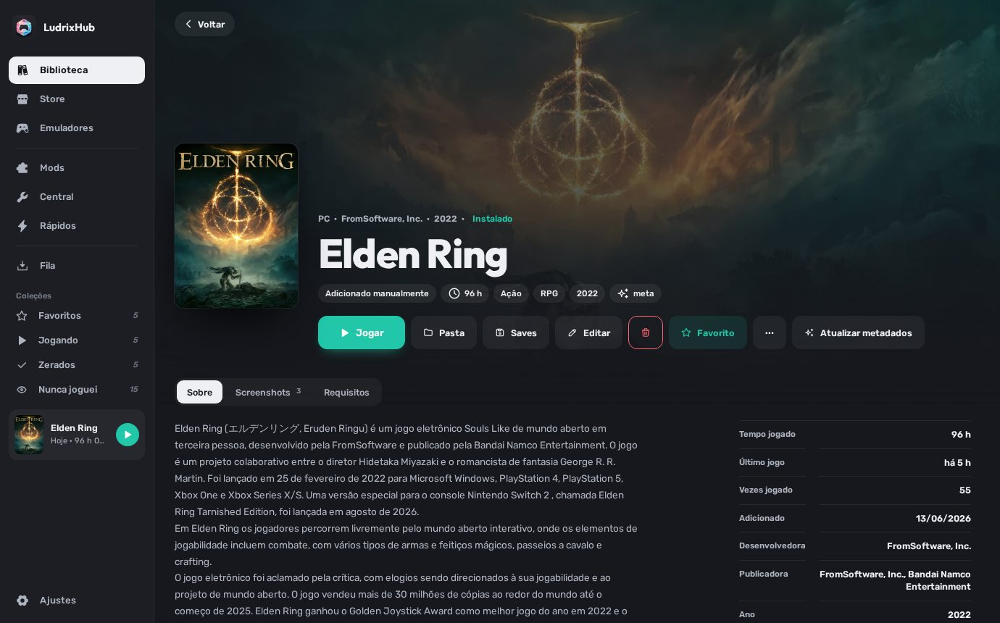
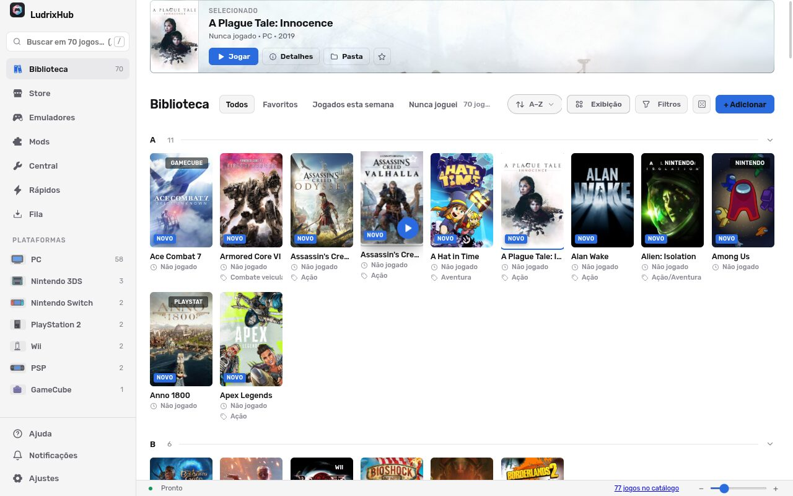
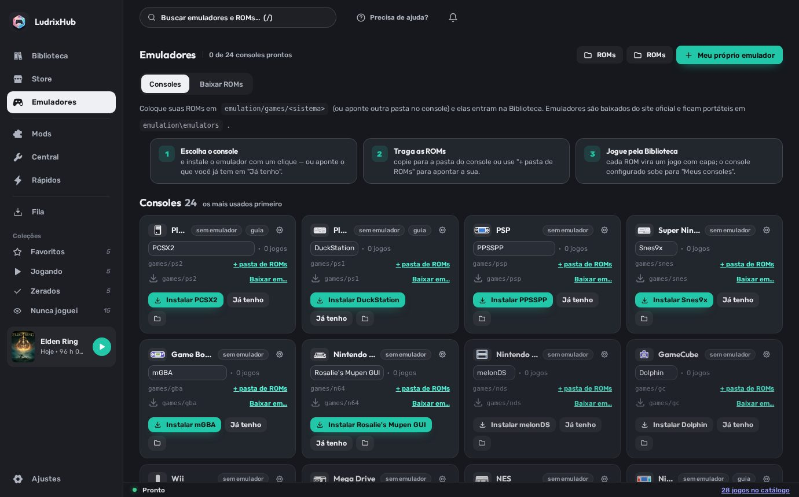
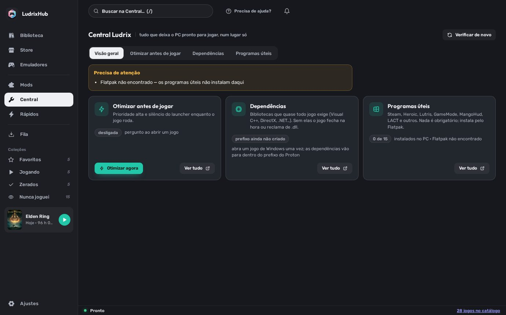
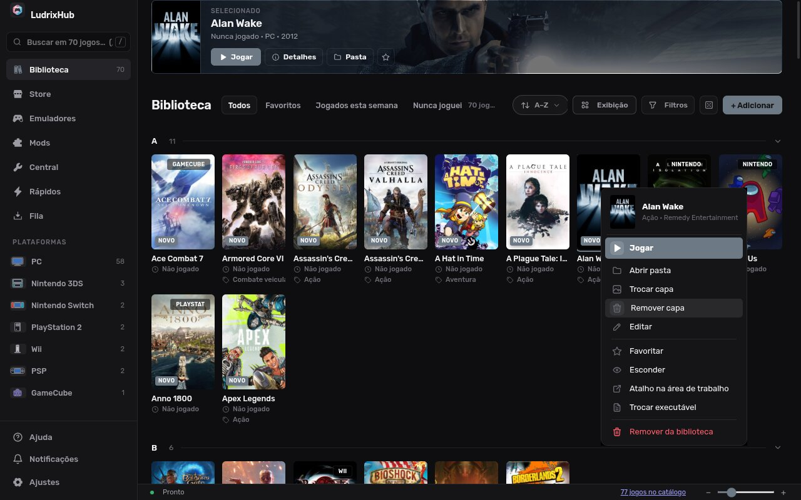
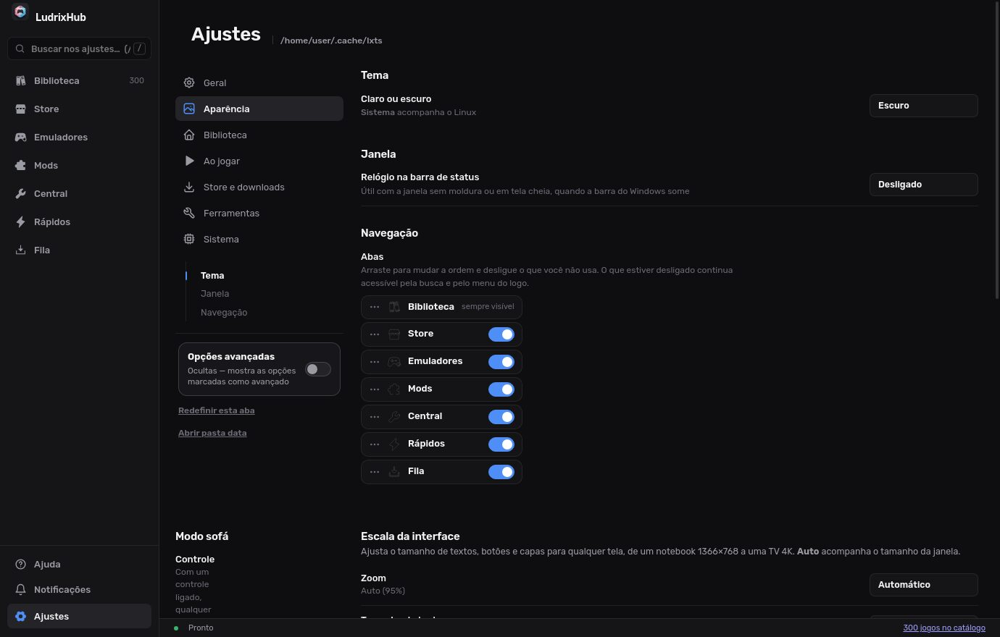

<p align="center">
  
</p>

<h1 align="center">LudrixHub</h1>

<p align="center">
  Launcher de jogos portátil para Windows.<br>
  Jogos de PC, emulados e rápidos numa biblioteca só · Store alimentada por listas que você escolhe · emuladores prontos · Modo Console.
</p>

<p align="center">
  <a href="https://github.com/wolffZ-prog/Ludrix/releases/latest"></a>
  <a href="https://github.com/wolffZ-prog/Ludrix/releases"></a>
  
  
  <a href="LICENSE"></a>
</p>

<p align="center">
  <a href="#download">Download</a> ·
  <a href="#o-que-ele-faz">O que ele faz</a> ·
  <a href="#capturas">Capturas</a> ·
  <a href="#fontes-de-jogos">Fontes</a> ·
  <a href="#compilar">Compilar</a> ·
  <a href="docs/">Documentação</a> ·
  <a href="README.en.md">English</a>
</p>

<p align="center">
  
</p>

---

## Download

| Arquivo | Para quem |
|---|---|
| **`Ludrix-<versão>.zip`** | Programa pronto. Extrai em qualquer pasta (pode ser pendrive) e abre `Ludrix.exe`. Não instala nada no sistema. |
| `ludrix-<versão>-patch.lxup` | Atualização. O Ludrix baixa e aplica sozinho em **Ajustes → Sistema → Checar atualizações**; também dá pra arrastar o arquivo pra janela. |
| `ludrix-<versão>-full.lxup` | Atualização completa (programa + runtime). Só aparece quando o runtime muda — é a que leva o 3.0.x para o 4.0.0. |
| `Ludrix-<versão>-src.zip` | Código-fonte desta mesma versão, pra compilar com `build.bat`. |
| `LudrixHub-<versão>-x86_64.AppImage` | Linux (experimental). Dá permissão de execução e abre; dados em `~/.local/share/Ludrix`. |

Última versão: **[Releases](https://github.com/wolffZ-prog/Ludrix/releases/latest)**. Histórico completo em [CHANGELOG.md](CHANGELOG.md).

Requisitos: Windows 10 ou 11, 64 bits. Nada de conta, login, WebView2 ou instalação: o runtime vem dentro da pasta.

**Vindo do 3.0.x:** abra o Ludrix que você já usa → Ajustes → Checar atualizações. Ele baixa o 4.0.0, troca o motor e reabre com a mesma biblioteca, capas, configurações e emuladores. Nada precisa ser baixado nem configurado de novo.

## O que ele faz

**Biblioteca**
- Jogos de PC (`.exe`, atalhos, pastas inteiras), ROMs e jogos rápidos (Flash/HTML5) na mesma tela, com capas, categorias, filtros combináveis e busca com prefixos (`dev:`, `ano:`, `gen:`, `sis:`, `origem:`).
- Grade em ordem alfabética com divisórias por letra e atalhos Todos / Favoritos / Jogados esta semana / Nunca joguei; faixa "Continuar" com os últimos jogados. Um clique abre o painel lateral do jogo (Jogar, tempo, última vez, pasta, saves, mods, capa); dois cliques ou botão direito abrem os detalhes. Temas escuro e claro, só cor sólida e linha fina.
- Importa de Playnite, Steam, Epic, GOG, Ubisoft Connect, EA app, Battle.net, Amazon Games e itch.io. Os nomes que você digita nunca são alterados.
- Capas, descrição, ano, desenvolvedora, screenshots e requisitos buscados automaticamente (Steam, GOG, Wikipedia, Wikidata — sem chave), com lista de candidatos pra escolher o jogo certo; tudo editável. Compara os requisitos com o seu PC.
- Status (planejo, jogando, zerado, 100%, em espera, abandonado) e nota de 1 a 10 por jogo; agrupar por status, nota, gênero, ano ou desenvolvedora. Backup automático de saves.
- Botão direito em qualquer jogo: jogar, abrir pasta, trocar capa, mods, saves, atalho na área de trabalho, verificar arquivos.

**Store por fontes**
- Nenhuma fonte de download embutida. Você adiciona listas `.json`, páginas de sites, coleções do archive.org, repositórios do GitHub ou pastas locais — e a Store passa a mostrar o que elas oferecem.
- Baixa por link direto, hospedeiros (MEGA, MediaFire, Pixeldrain, Google Drive, itch.io e outros) ou torrent (sem DHT, UPnP ou NAT-PMP); downloads em etapas, pausa, fila com histórico.
- Instala o que baixou: extrai `.zip`/`.7z`/`.rar`, roda instaladores, monta imagens de disco, pede atalho na área de trabalho só se você quiser.
- Recompilações e ports nativos (N64, Xbox 360, PS1…) vêm direto do GitHub, sempre na versão mais recente. Lista pronta: [`Recomps.json`](docs/FONTES.md#recomps).

**Emuladores**
- 24 sistemas e 45 emuladores catalogados (PCSX2, DuckStation, PPSSPP, Dolphin, melonDS, Xenia, mGBA, Snes9x, Rosalie's Mupen GUI, Eden…). Instala do site oficial com um clique, tudo portátil dentro da pasta do Ludrix.
- Aponta a pasta de ROMs de cada console e elas entram na Biblioteca. Vários emuladores por sistema; BIOS detectada.

**Central**
- Dependências que quase todo jogo exige (Visual C++, DirectX, .NET, PhysX…): detecta o que falta e instala.
- Modo Game: fecha o supérfluo antes de jogar e restaura depois. Programas úteis via winget e Microsoft Store. Minecraft: detecta o launcher oficial e as alternativas.

**Modo Console**
- Interface separada para TV e controle: capas grandes, navegação por analógico/D-pad, mesmas tabs do launcher. Abre pelo ícone ou automaticamente com controle conectado.
- Modo sofá no launcher normal: com um controle ligado, qualquer botão passa a navegação para ele (D-pad move, A seleciona, B volta, X menu, Y favorito, LB/RB abas, Start joga).

**Aparência**
- Tema escuro e claro. Fonte Rubik, ícones Tabler, escala adaptativa, opção de reduzir movimento.
- Interface em português do Brasil e inglês.

**Sistema**
- Portátil de verdade: tudo fica na pasta (`data/`, `games/`, `emulation/`, `downloads/`). Nada é gravado fora dela.
- Bandeja do sistema, iniciar com o Windows (opcional), instância única por pasta.
- Atualizações assinadas (Ed25519). Pacote sem assinatura válida não é aplicado. Se uma atualização não abrir duas vezes seguidas, o Ludrix volta sozinho pra versão anterior. Cada atualização substitui o programa inteiro — nada da versão antiga fica pra trás, só os seus dados.
- Exportar e importar a biblioteca inteira (configurações, capas, metadados) em um arquivo. Exporta para a Steam.

## Capturas

<table>
  <tr>
    <td><br><sub>Detalhes: descrição, metadados, screenshots, requisitos</sub></td>
    <td><br><sub>Tema claro</sub></td>
  </tr>
  <tr>
    <td><br><sub>Emuladores: instala, aponta ROMs, escolhe o núcleo</sub></td>
    <td><br><sub>Central: dependências, Modo Game, programas úteis</sub></td>
  </tr>
  <tr>
    <td><br><sub>Menu do botão direito</sub></td>
    <td><br><sub>Ajustes</sub></td>
  </tr>
</table>

## Fontes de jogos

A Store só mostra o que as suas fontes trazem. Tipos aceitos em **Store → Fontes**:

| Tipo | Exemplo |
|---|---|
| Lista `.json` (`ludrix-pack/1`) | arquivo local ou link; formato em [docs/FONTES.md](docs/FONTES.md) |
| Página de site | o Ludrix lê a página e lista os jogos que encontrar |
| Coleção ou item do archive.org | link da coleção |
| Repositório do GitHub | releases com build Windows |
| Pasta local | jogos que você já tem em outro disco |
| Listas no formato Hydra | compatível |

Pacotes prontos ficam em cada release: `Colecoes.zip` com **PC Collections**, **ROMs Collection** e **Recomps** (91 recompilações/ports com build Windows, baseado no [Recompendium](https://github.com/Nio03/unricopie)).

## Compilar

```bat
git clone https://github.com/wolffZ-prog/Ludrix.git
cd Ludrix
build.bat                     :: instala o Node se faltar, baixa as dependências e gera release\<versão>\Ludrix\
node tools\build.js all       :: pasta + zip + patch + full + src + feed (assinados, se a chave existir)
```

Precisa de Windows e Node.js 20+ (`build.bat` instala pelo winget se não tiver). Detalhes em [docs/COMPILAR.md](docs/COMPILAR.md).

Estrutura:

```
src/main/        processo principal (TypeScript): servidor local, biblioteca, Store, emuladores, atualizador, bandeja
src/main/assets/ catálogos (emuladores, dependências, categorias), ícones, executáveis nativos
src/renderer/    interface (HTML/CSS/JS) e modo console
tools/build.js   build, empacotamento, assinatura, feed de atualização, publicação
tools/native/    Ludrix.exe, LudrixConsole.exe e ludrix-gamepad.exe (C, mingw)
docs/            documentação
```

## Atualizações

O Ludrix consulta este repositório (`releases/latest/download/ludrix-updates.json`). Quando sai versão nova, avisa; você aceita, ele baixa, confere a assinatura, aplica e reabre. Também dá pra apontar um endereço `https` próprio ou aplicar um `.lxup` manualmente. Mais em [docs/ATUALIZACOES.md](docs/ATUALIZACOES.md).

## Segurança

- Servidor local só em `127.0.0.1`, porta aleatória, token por sessão, checagem de origem e CSP; renderer em sandbox.
- Pacotes de atualização assinados; a chave privada nunca está no código.
- Torrent sem DHT, UPnP, NAT-PMP ou descoberta local.
- Sem telemetria, sem conta, sem anúncios.

Achou um problema? Veja [SECURITY.md](SECURITY.md).

## Contribuir

Issues e pull requests são bem-vindos — leia [CONTRIBUTING.md](CONTRIBUTING.md) antes. Regras curtas: código sem comentários nem docstrings, interface direta e sem narração, nada roda em segundo plano sem o usuário ligar.

## Créditos

**WOLFFZ — criador e idealizador do projeto.**

Bibliotecas: [Electron](https://www.electronjs.org/), [TypeScript](https://www.typescriptlang.org/), [webtorrent](https://webtorrent.io/), [adm-zip](https://github.com/cthackers/adm-zip), [electron-log](https://github.com/megahertz/electron-log). Ícones baseados em [Tabler Icons](https://tabler.io/icons). Fonte [Rubik](https://fonts.google.com/specimen/Rubik).

Licença [MIT](LICENSE). Os jogos, capas e marcas pertencem aos seus donos; o Ludrix não distribui jogos.
