<p align="center">
  
</p>

<h1 align="center">LudrixHub</h1>

<p align="center">
  Launcher de jogos portátil para Windows.<br>
  Biblioteca, emuladores e Store num lugar só — sem conta, sem instalador, sem nada rodando escondido.
</p>

<p align="center">
  <a href="https://github.com/wolffZ-prog/Ludrix/releases/latest"></a>
  <a href="https://github.com/wolffZ-prog/Ludrix/releases"></a>
  
  
  <a href="LICENSE"></a>
</p>

<p align="center">
  <a href="#download">Download</a> ·
  <a href="#como-o-ludrix-está-hoje">Como está hoje</a> ·
  <a href="#capturas">Capturas</a> ·
  <a href="#temas">Temas</a> ·
  <a href="#fontes-de-jogos">Fontes</a> ·
  <a href="#compilar">Compilar</a> ·
  <a href="docs/">Documentação</a> ·
  <a href="README.en.md">English</a>
</p>

<p align="center">
  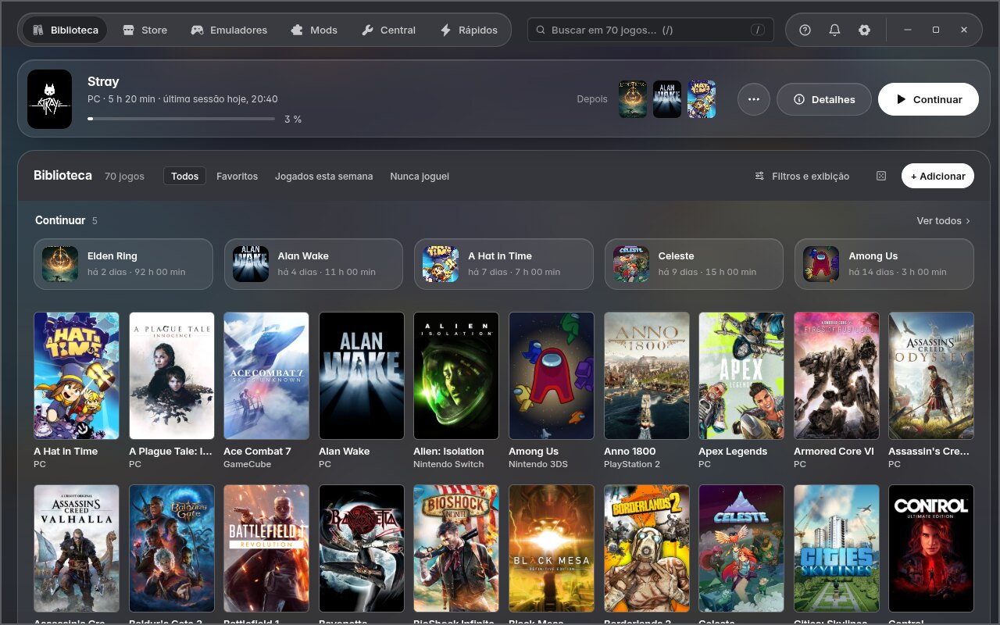
</p>

---

## Download

| Arquivo | Para quem |
|---|---|
| **`LudrixHub-Setup-<versão>-x64.exe`** | Instalador simples para Windows 64 bits: escolhe a pasta (padrão `C:\Users\<você>\Ludrix`), cria atalhos, sem pedir administrador. Jogos ficam dentro da pasta escolhida; ajustes, biblioteca e backups em `%APPDATA%\.ludrixdata`. |
| **`Ludrix-<versão>.zip`** | Portátil. Extrai em qualquer pasta e abre `Ludrix.exe`. Nada é instalado no sistema. Para pendrive/HD externo, crie um `portable.txt` vazio ao lado do exe e tudo fica dentro da pasta. |
| `ludrix-<versão>-patch.lxup` | Atualização. O Ludrix baixa e aplica sozinho em **Ajustes → Sistema → Checar atualizações**; também pode ser arrastado para a janela. |
| `ludrix-<versão>-full.lxup` | Atualização completa (programa + runtime). Só aparece quando o runtime muda. |
| `LudrixHub-<versão>-x86_64.AppImage` | Linux (experimental). Dados em `~/.local/share/Ludrix`. |

Última versão: **[Releases](https://github.com/wolffZ-prog/Ludrix/releases/latest)**. Histórico completo em [CHANGELOG.md](CHANGELOG.md). Só as duas releases mais recentes ficam publicadas; versões antigas são removidas.

Requisitos: Windows 10 ou 11, 64 bits. Sem conta, login, WebView2 ou instalação — o runtime vem dentro da pasta.

## Como o Ludrix está hoje

A série 4.0 trocou o motor antigo (Python) por Electron + TypeScript, mantendo a mesma pasta de dados. A versão atual é a **4.0.20**, e o estado do projeto é este:

- **Uma biblioteca só.** Jogos de PC, ROMs e jogos rápidos (Flash/HTML5) aparecem juntos, em grade alfabética com divisórias por letra, capas, categorias e filtros combináveis. Abas no alto (Biblioteca, Store, Emuladores…), busca ao lado, filtros em uma linha e cada capa com sistema, ano e última vez jogada. Um clique na capa abre o painel lateral com Jogar, tempo, pasta e gêneros; duplo clique abre os detalhes.
- **Store alimentada por fontes.** Nenhum catálogo vem embutido. A Store só mostra o que as listas `.json`, páginas, coleções do archive.org, repositórios do GitHub ou pastas locais adicionadas pelo usuário oferecem. Download direto, hospedeiros e torrent (sem DHT, UPnP ou NAT-PMP).
- **Emuladores prontos.** 25 sistemas e 45 emuladores catalogados, instalados do site oficial com um clique e guardados dentro da pasta do Ludrix. As ROMs entram na Biblioteca com capa e são abertas pelo emulador escolhido para aquele sistema.
- **Uma cara embutida, a Padrão, e 30 caras como pacotes.** O Ludrix vem só com a **Padrão** (escuro e claro): fundo grafite com uma parede iridescente desfocada, painéis de vidro fumê (ou leitoso, no claro), cabeçalho editorial, lateral numerada e rótulos monoespaçados — mais a "Grafite (Legacy)" para quem prefere a antiga. As outras 30 caras (Apex, Sampler, Fatias, Circuito P&B, Hex Azul, Rádio Militar, Pegboard Vidro, Metal Verde…) não ficam dentro do programa: cada uma é um pacote `.lxtheme` assinado, com o seu próprio front end (lateral, barra em painel, dock de pads, fatias…), escuro e claro, que você importa em Ajustes › Aparência › Temas instalados (ou soltando o arquivo na janela). Os pacotes são distribuídos à parte, no `Ludrix-Temas-<versão>.zip` — não fazem parte do código-fonte. Temas externos `.lxtheme` de terceiros continuam funcionando por cima da Padrão.
- **Movimento leve.** As animações são curtas e independentes das configurações de animação do Windows; "Reduzir movimento" desliga tudo. Trocar de página é instantâneo, sem piscar nem deslocar o conteúdo.
- **Perfis locais.** Cada pessoa com seu tema, aparência, exibição e preferências; a biblioteca, capas, saves e downloads são os mesmos para todos. Sem senha: ao abrir, o Ludrix pergunta quem vai jogar (opcional) e a troca fica no avatar da barra. Foto opcional (PNG até 64×64); perfis podem ser apagados a qualquer momento.
- **Barra de navegação a gosto.** No alto (padrão), lateral só ícones, lateral com nomes, embaixo, ou **solta**: separada do conteúdo, com cantos arredondados.
- **Rápido em HDD.** A biblioteca abre de um cache frio enquanto o disco acorda; a verificação de integridade roda depois, sem segurar a tela. Um script opcional (`Ludrix-HDD.ps1`) ajusta o Windows para HDs mecânicos sem tocar nos dados.
- **Previsível.** Jogos, emuladores e downloads ficam na pasta do programa; ajustes, biblioteca, saves copiados, temas e backups ficam em `%APPDATA%\.ludrixdata` (ou em `data/` dentro da pasta, se existir um `portable.txt` — pendrive, HD externo). Nada no registro, nada roda depois de Sair, e cada atualização substitui o programa inteiro mantendo só os dados do usuário. **Backup em um clique**: Ajustes › Sistema › Backup gera um zip com tudo que é seu, na pasta que você escolher, e restaura de volta.
- **Em português do Brasil e inglês**, com tudo que é adicionado chegando nos dois idiomas ao mesmo tempo.

## O que ele faz

**Biblioteca**
- Importa de Playnite, Steam, Epic, GOG, Ubisoft Connect, EA app, Battle.net, Amazon Games, itch.io, Heroic, ES-DE, LaunchBox, Pegasus e atalhos do Windows. Nomes digitados pelo usuário nunca são alterados.
- Capas, arte de fundo, descrição, ano, desenvolvedora, screenshots e requisitos buscados automaticamente (Steam, GOG, Wikipedia, Wikidata — sem chave de API), com lista de candidatos para escolher o jogo certo. Tudo editável; a imagem escolhida substitui a anterior.
- Status (planejo, jogando, zerado, 100 %, em espera, abandonado), nota de 1 a 10, favoritos, etiquetas (`tag:` na busca), coleções e grupos. Busca com prefixos: `dev:`, `ano:`, `gen:`, `sis:`, `origem:`, `tag:`.
- Botão direito em qualquer jogo: jogar, abrir pasta, trocar capa, mods, saves, atalho na área de trabalho, verificar arquivos, mover pasta do jogo, Requisitos × PC.
- Duplicatas detectadas e nunca mostradas duas vezes. Backup automático de saves. Exportar/importar a biblioteca inteira em um arquivo; exportar para a Steam.
- Navegação por controle (modo sofá), dado para sortear um jogo, slideshow de capas, atalhos de teclado configuráveis, Discord Rich Presence opcional.

**Store por fontes**
- Fontes aceitas em **Store → Fontes**: lista `.json` (`ludrix-pack/1`), página de site, coleção ou item do archive.org, repositório do GitHub, pasta local, listas no formato Hydra.
- Downloads em etapas, pausa, agendamento, fila com histórico. Extrai `.zip`/`.7z`/`.rar`, roda instaladores, monta imagens de disco e pergunta antes de criar atalhos.
- Recompilações e ports nativos (N64, Xbox 360, PS1…) vêm direto do GitHub, sempre na versão mais recente. Lista pronta: [`Recomps.json`](docs/FONTES.md#recomps).

**Emuladores**
- PCSX2, DuckStation, PPSSPP, Dolphin, melonDS, Xenia, mGBA, Snes9x, Rosalie's Mupen GUI, Eden e outros. Vários emuladores por sistema, BIOS detectada, varredura rasa de pastas de ROMs (nunca trava a interface).

**Central**
- Dependências que quase todo jogo exige (Visual C++, DirectX, .NET, PhysX…): detecta o que falta e instala em lote. Minecraft: detecta o launcher oficial e as alternativas. Espaço em disco por pasta.

**Modo Console**
- Executável separado (`LudrixConsole.exe`) para TV e controle: capas grandes, navegação por analógico/D-pad, mesmas abas do launcher.

**Sistema**
- Bandeja do sistema no estilo Playnite, iniciar com o Windows (opcional), instância única por pasta, memória do tamanho e posição da janela, zip de diagnóstico, vigilância de travamentos.
- Atualizações assinadas (Ed25519). Pacote sem assinatura válida não é aplicado. Se uma atualização não abrir duas vezes seguidas, o Ludrix volta sozinho para a versão anterior.

## Capturas

<table>
  <tr>
    <td>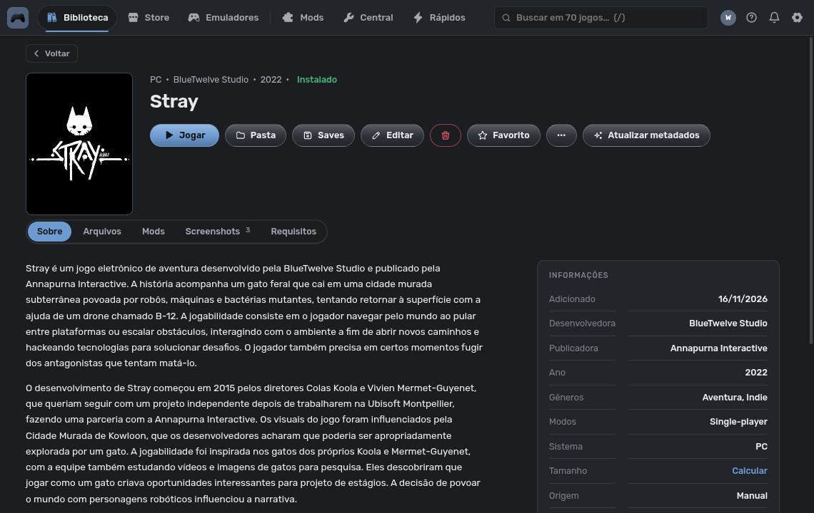<br><sub>Detalhes: descrição, metadados, screenshots, requisitos</sub></td>
    <td>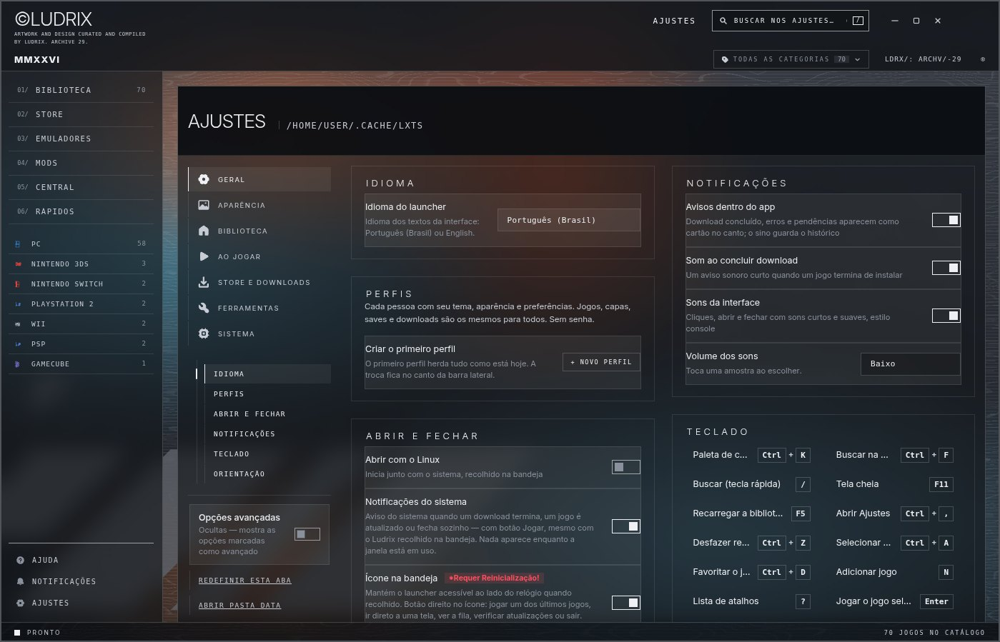<br><sub>Perfis locais: quem vai jogar, sem senha</sub></td>
  </tr>
  <tr>
    <td>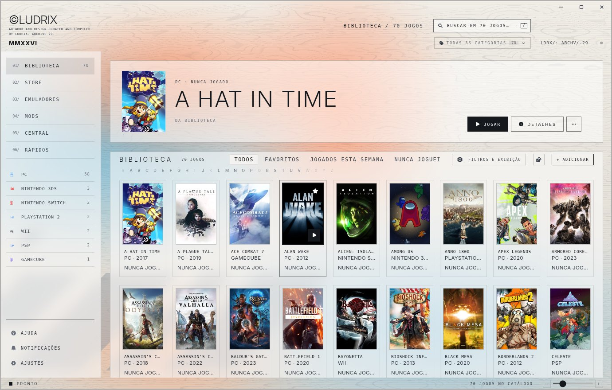<br><sub>Arquivo claro: o mesmo vidro, leitoso sobre a parede</sub></td>
    <td>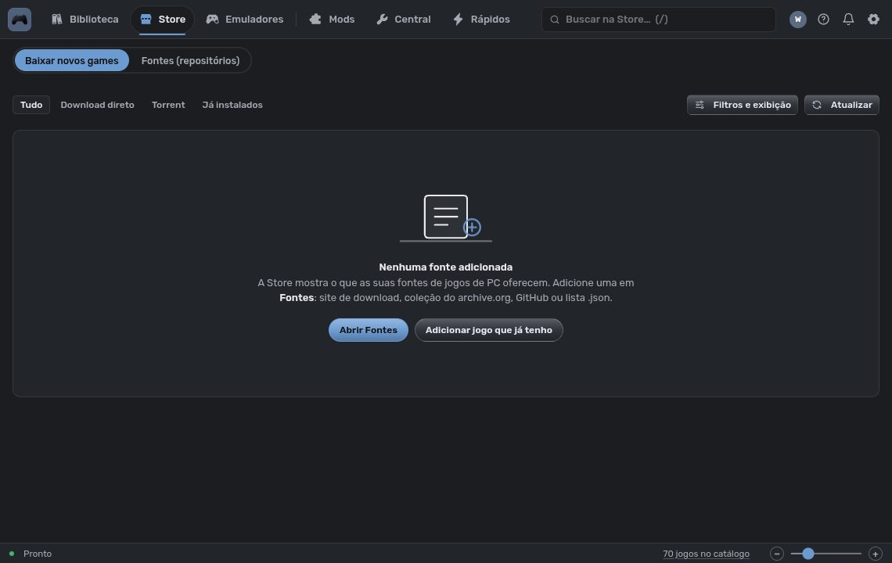<br><sub>Store: vazia até que uma fonte seja adicionada</sub></td>
  </tr>
  <tr>
    <td>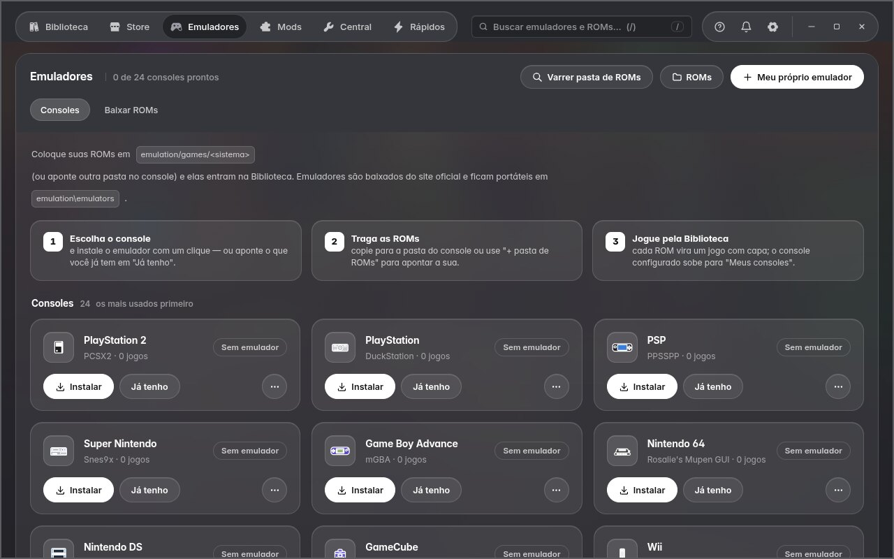<br><sub>Emuladores: instala, aponta ROMs, escolhe o núcleo</sub></td>
    <td>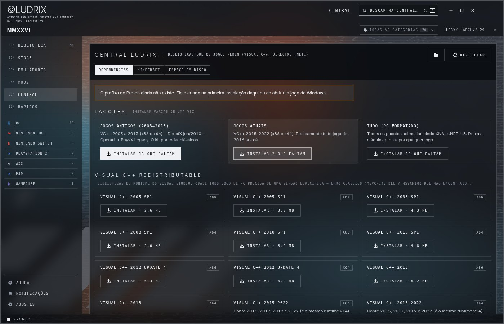<br><sub>Central: dependências, Minecraft, espaço em disco</sub></td>
  </tr>
  <tr>
    <td>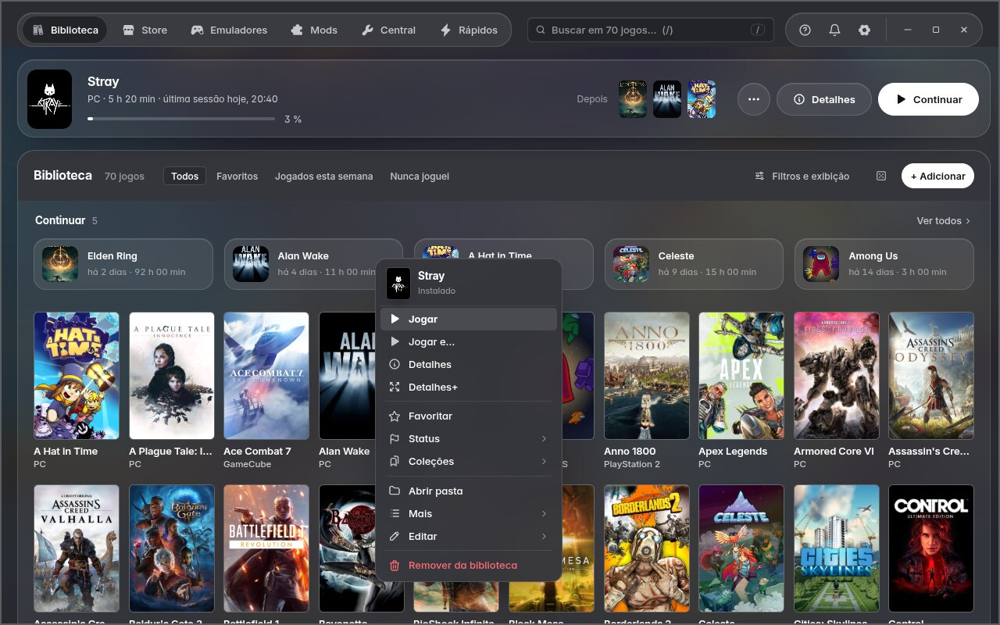<br><sub>Menu do botão direito: no Windows é o menu nativo; aqui, a versão interna</sub></td>
    <td>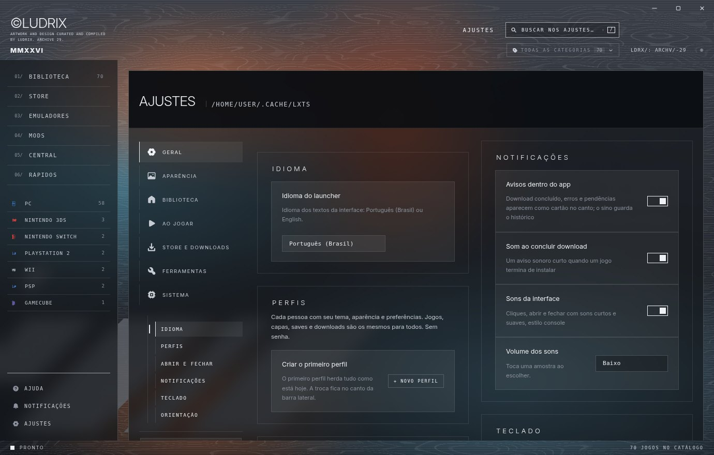<br><sub>Ajustes: abas em duas colunas, efeito imediato</sub></td>
  </tr>
</table>

## Temas

O Ludrix vem com duas caras embutidas — **Padrão** (escuro e claro) e **Grafite (Legacy)**. Todo o resto é tema importado, de dois tipos:

- **Pacote de cara** (`.lxtheme` com `theme.json{"face": "<cara>"}` + `face.css` + `dark.css` + `light.css` + `preview.png`): um front end completo, com a própria disposição (lateral, barra em painel, dock, fatias…), escuro e claro. As **30 caras oficiais** saem assim, uma por arquivo ou todas em `Ludrix-Caras-30.lxtheme`, assinadas, no `Ludrix-Temas-<versão>.zip` (separado do programa).
- **Tema de cores** (`theme.json` com `vars`, destaque, layout da barra, ícones e, se quiser, `extra.css`, papéis de parede e fontes): o formato clássico, por cima da Padrão. Formato completo em [docs/TEMAS.md](docs/TEMAS.md).

Importa-se em **Ajustes › Aparência › Temas instalados › Importar** (ou soltando o arquivo na janela); tema do sistema e agenda claro/escuro também estão lá.

<table>
  <tr>
    <td>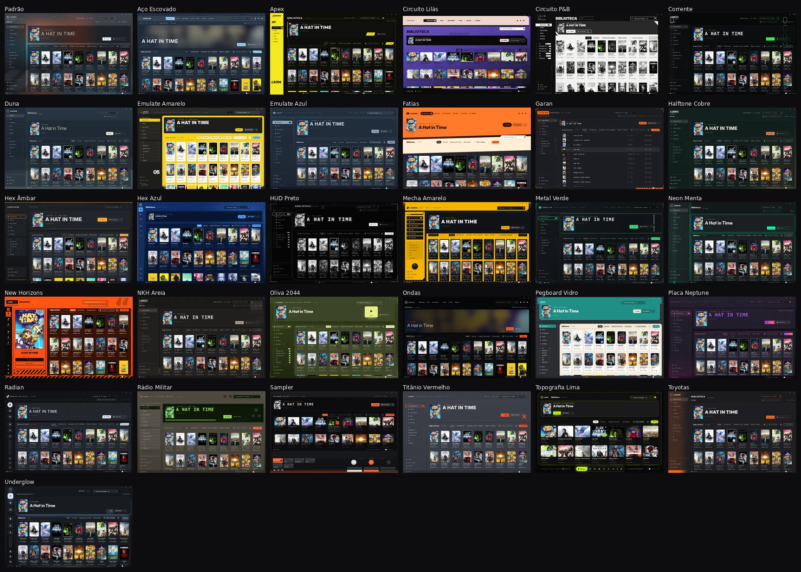<br><sub>Padrão + 30 pacotes, escuro</sub></td>
    <td>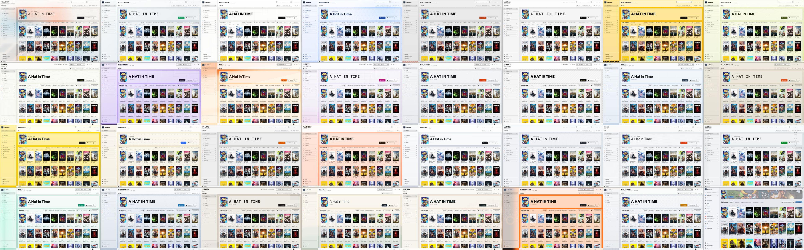<br><sub>As mesmas, claro</sub></td>
  </tr>
</table>

## Fontes de jogos

A Store só mostra o que as fontes trazem. Tipos aceitos em **Store → Fontes**:

| Tipo | Exemplo |
|---|---|
| Lista `.json` (`ludrix-pack/1`) | arquivo local ou link; formato em [docs/FONTES.md](docs/FONTES.md) |
| Página de site | o Ludrix lê a página e lista os jogos que encontrar |
| Coleção ou item do archive.org | link da coleção |
| Repositório do GitHub | releases com build Windows |
| Pasta local | jogos que já existem em outro disco |
| Listas no formato Hydra | compatível |

Pacotes prontos acompanham as releases: `Colecoes.zip` com **PC Collections**, **ROMs Collection** e **Recomps** (recompilações/ports com build Windows, baseado no [Recompendium](https://github.com/Nio03/unricopie)).

## Compilar

```bat
git clone https://github.com/wolffZ-prog/Ludrix.git
cd Ludrix
build.bat                     :: instala o Node se faltar, baixa as dependências e gera release\<versão>\Ludrix\
node tools\build.js all       :: pasta + zip + patch + full + src + feed (assinados, se a chave existir)
```

Precisa de Windows e Node.js 20+ (`build.bat` instala pelo winget se não tiver). `node tools\check.js` roda tsc, confere sintaxe do renderer, JSONs, tradução, rotas e chaves de configuração — é o portão antes de qualquer release. Detalhes em [docs/COMPILAR.md](docs/COMPILAR.md).

Estrutura:

```
src/main/        processo principal (TypeScript): servidor local, biblioteca, Store, emuladores, atualizador, bandeja
src/main/assets/ catálogos (emuladores, dependências, categorias), ícones, executáveis nativos
src/renderer/    interface (HTML/CSS/JS), aparências (themes/), modo console, traduções
tools/build.js   build, empacotamento, assinatura, feed de atualização, publicação
tools/check.js   verificações de integridade do código
tools/native/    Ludrix.exe, LudrixConsole.exe e ludrix-gamepad.exe (C, mingw)
docs/            documentação e capturas
```

## Atualizações

O Ludrix consulta este repositório (`releases/latest/download/ludrix-updates.json`). Quando sai versão nova, avisa; aceita-se, ele baixa, confere a assinatura, aplica e reabre. Correções rápidas (`-hfN`) chegam pelo mesmo caminho e trocam só os arquivos alterados. Também é possível apontar um endereço `https` próprio ou aplicar um `.lxup` manualmente. Mais em [docs/ATUALIZACOES.md](docs/ATUALIZACOES.md).

## Segurança

- Servidor local só em `127.0.0.1`, porta estável por pasta, token por sessão, checagem de origem, lista de caminhos permitidos e CSP; renderer em sandbox.
- Pacotes de atualização assinados com Ed25519; a chave privada nunca está no código.
- Torrent sem DHT, UPnP, NAT-PMP ou descoberta local.
- Sem telemetria, sem conta, sem anúncios, sem plugins, sem IA.

Achou um problema? Veja [SECURITY.md](SECURITY.md).

## Contribuir

Issues e pull requests são bem-vindos — leia [CONTRIBUTING.md](CONTRIBUTING.md) antes. Regras curtas: código sem comentários nem docstrings, interface direta e sem narração, tudo em pt-BR e inglês ao mesmo tempo, nada roda em segundo plano sem o usuário ligar.

## Créditos

**WOLFFZ — criador e idealizador do projeto.**

Bibliotecas: [Electron](https://www.electronjs.org/), [TypeScript](https://www.typescriptlang.org/), [webtorrent](https://webtorrent.io/), [adm-zip](https://github.com/cthackers/adm-zip), [electron-log](https://github.com/megahertz/electron-log). Ícones baseados em [Tabler Icons](https://tabler.io/icons). Fonte [Rubik](https://fonts.google.com/specimen/Rubik).

Licença [MIT](LICENSE). Os jogos, capas e marcas pertencem aos seus donos; o Ludrix não distribui jogos.
